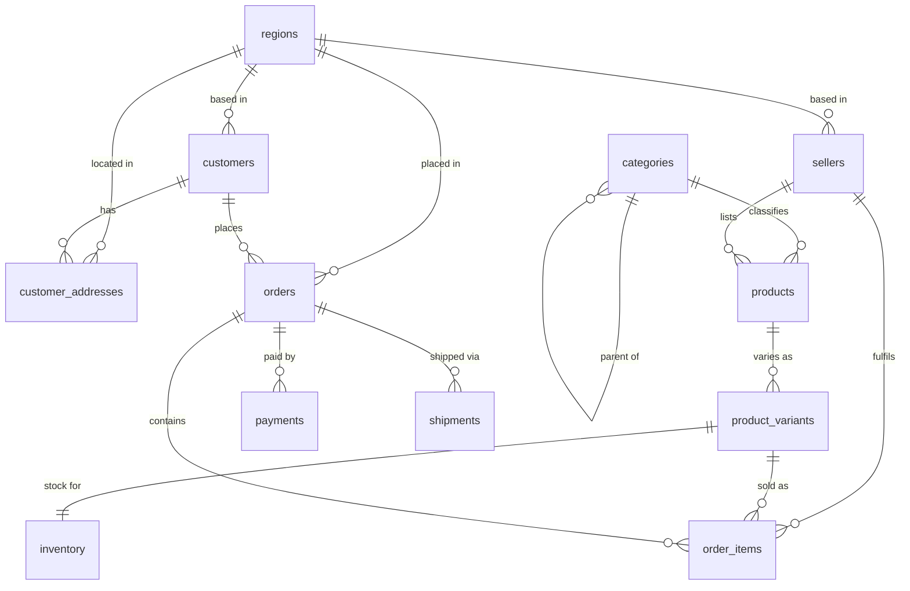

# Data model

Twelve tables in third normal form, modelling a marketplace: customers
buy from sellers, sellers list products, products have SKU-level
variants, variants carry stock, and orders draw them down.

The domain is chosen for its shape rather than its novelty. It produces
exactly the tensions worth demonstrating: a dimension/fact split, a
self-referencing hierarchy, a time-ordered fact table large enough that
partitioning matters, and one hot mutable row per SKU that many writers
contend for at once.



| # | Table | Grain | Notes |
|---|:---|:---|:---|
| 1 | `regions` | one row per market | currency lives here, so an order's currency is derived rather than repeated |
| 2 | `customers` | one row per customer | natural key `customer_uid` owned upstream, surrogate `customer_id` owned here |
| 3 | `customer_addresses` | one row per customer per kind | `UNIQUE (customer_id, kind)` doubles as the ETL's conflict target |
| 4 | `sellers` | one row per seller | |
| 5 | `categories` | one row per node | self-referencing hierarchy, `depth` capped by CHECK |
| 6 | `products` | one row per listing | |
| 7 | `product_variants` | one row per SKU | the sellable unit |
| 8 | `inventory` | one row per SKU | the contended row; `qty_available` is GENERATED |
| 9 | `orders` | one row per order | RANGE partitioned monthly on `placed_at` |
| 10 | `order_items` | one row per line | largest table; partitioned on the same key |
| 11 | `payments` | one row per payment attempt | an order may have several |
| 12 | `shipments` | one row per parcel | |

Pipeline metadata lives in a separate schema (`qq_meta`) and rollups in
another (`qq_mart`), so "twelve tables" stays literally true of the
domain model and an operator can grant read on the control plane without
granting anything on the data.

---

## Decisions worth defending

### Surrogate keys everywhere, natural keys constrained

Every table carries both. `customer_uid` is what the source system
calls a customer; `customer_id` is what we call it. Joins use the
surrogate — 8 bytes, stable, never re-issued — while the ETL matches on
the natural key, which is the only thing a feed actually contains.

Getting this wrong in either direction hurts. Join on the natural key
and every index in the schema carries a variable-length string. Ingest
on the surrogate and you cannot, because the feed does not know it.

### Third normal form, and where it stops

The model is 3NF with two deliberate exceptions, both on the fact
tables:

- `orders.region_id` duplicates `customers.region_id`. It is not
  redundant, it is *historical*: a customer who relocates should not
  retroactively move last year's revenue to a different region.
- `order_items.placed_at` and `order_items.seller_id` are copied down
  from the parent. `placed_at` is what makes the child partitionable on
  the same key as its parent; `seller_id` avoids a two-hop join
  (`order_items → product_variants → products`) on the single most
  common analytical query in the system.

Both are denormalisations with a stated reason. Both are enforced
consistent by the ETL rather than hoped to be.

### Enums rather than lookup tables

`order_status`, `payment_status` and friends are native enums. They cost
four bytes, they make an invalid status unrepresentable, and they need
no join to read. A lookup table would be the right call if these values
were user-editable or carried attributes. They are neither: they are the
fixed vocabulary of the domain, and adding a value is a migration
either way.

### Constraints as the last line of defence

```sql
CONSTRAINT inventory_oversell_ck CHECK (qty_reserved <= qty_on_hand)
```

The application prevents overselling with row-level locking. The
database refuses to record it regardless. Those are not the same
mechanism and they are not redundant — the CHECK is what catches the
code path someone adds next year that forgot to take the lock.

`qty_available` being `GENERATED ALWAYS AS (qty_on_hand - qty_reserved)
STORED` belongs to the same idea: an invariant expressed once, in the
schema, rather than recomputed in every caller that might get it wrong.

### Partitioning

`orders` and `order_items` are RANGE partitioned by month on
`placed_at`.

- **Monthly, not daily.** The access pattern is "recent window" plus a
  long tail of per-customer history. Monthly keeps the partition count
  in the dozens, which keeps planning time flat; daily would put it in
  the thousands, where planning starts costing more than the scan it
  saves.
- **Same key on both tables**, which is what lets the planner do
  partition-wise joins.
- **A DEFAULT partition** as a backstop. It should always be empty;
  `test_default_partition_is_a_backstop_not_a_dumping_ground` fails if
  it is not, because a non-empty default means the calendar has drifted
  past the partitions that exist and pruning is silently degraded.

The cost is real and worth naming: a partitioned table's primary key
must contain the partition key, so `orders` has a composite key
`(order_id, placed_at)`, and every foreign key pointing at it is
composite too. That is why the natural key of an order is
`(order_uid, placed_at)` rather than `order_uid` alone.

### The mirror schema

`sql/001_schema.sql` is rendered twice, into `qq` (partitioned, indexed)
and `qq_baseline` (plain heap, primary keys only). Both hold identical
rows.

This exists so the performance claims are a measured A/B rather than an
assertion. It is also why `test_baseline_mirrors_optimized_columns`
exists: if the two schemas ever drift, the benchmark stops comparing
what it says it compares.

The baseline keeps its keys. It is meant to be a *naive* schema, not a
broken one — nobody ships a table with no primary key, and beating that
straw man would prove nothing.
